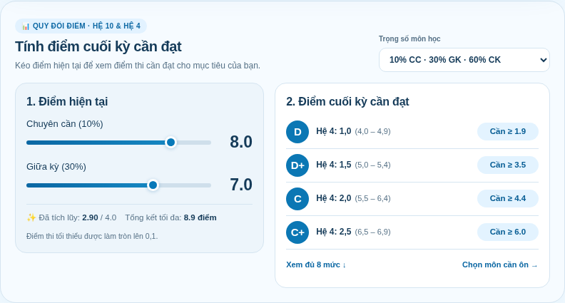

AZOTA LuzV · Khung tính điểm gọn
================================

Giữ giao diện xanh trắng và ảnh bìa 3D theo chủ đề.
Khung điểm dùng hai cột trên màn hình rộng, xếp dọc trên điện thoại;
kết quả theo từng hàng có huy hiệu. Mặc định hiện D đến C+,
nút Xem đủ 8 mức mở thêm B đến A+.

Điểm tối thiểu làm tròn lên 0,1 để đủ ngưỡng mục tiêu.
Các ngưỡng quy đổi và ba bộ trọng số giữ nguyên.
Đã kiểm tra 320/390/820/1360 px, sáng/tối, bàn phím, nhảy nhanh,
10.584 trường hợp tính điểm và giá Solo 5 môn không dùng mã = 75.000đ.

Chỉ cần lấy index.html và tải lên website; CSS, JS và ảnh bìa đã nhúng sẵn.
Nếu dùng QR thanh toán, đặt thêm ảnh thanh-toan.jpeg cùng thư mục.

SHA-256 của index.html:
088ed2a37a63c448c46bdd2f3a76dc5c680a39ed86cb7a921193bd6457d09fa2
