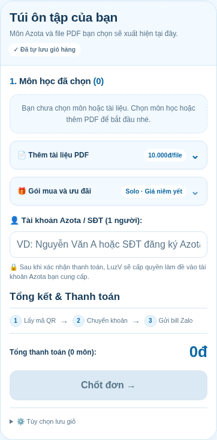
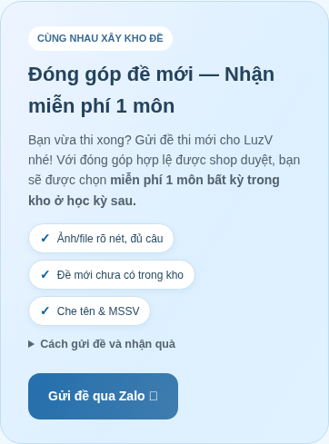

AZOTA LuzV · Túi ôn tập dạng thẻ
================================

Ví dụ giỏ có 3 môn Solo, không nhập mã:

Giỏ trống: 

Giữ tông xanh trắng, ảnh bìa 3D và phần tính điểm gọn.
Giỏ có bỏ từng mục, Xóa tất cả và danh sách cuộn. PDF, ưu đãi và bộ nhớ có thể thu gọn.
Ô tài khoản đổi theo gói 1/2/5 người. Nút Chốt đơn khóa khi trống và mở với cả đơn chỉ PDF.
Solo không tự giảm theo số môn; gói nhóm giảm 10% cho 3–4 môn, 15% từ 5 môn.
Mã nhập riêng tính sau ưu đãi nhóm; PDF không giảm giá và không được tính vào mốc số môn.

Mục Đóng góp đề:

Chỉ cần tải index.html lên website. Ảnh bìa, CSS và JS đã nhúng sẵn.
Nếu dùng QR thanh toán, đặt thêm ảnh thanh-toan.jpeg cùng thư mục.

Đã kiểm tra ở 320/390/820/1360 px, sáng/tối, giỏ điện thoại, lưu và xóa lựa chọn,
mua PDF riêng, mã ưu đãi, gói nhóm, tổng QR và hướng dẫn 5 bước.

SHA-256 của index.html:
4379d933fe2f7fb56d2da5e0453b9a149919ad97fdc6751dbe3cff57a76c29de
